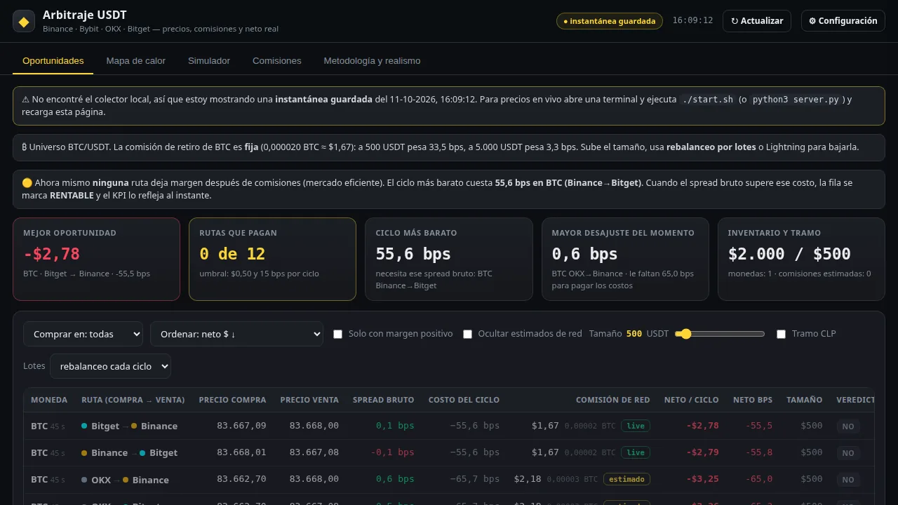

# Arbitraje USDT

> Doce rutas entre Binance, Bybit, OKX y Bitget, con un motor que resta comisiones, slippage, red y rebalanceo antes de decir que hay una oportunidad.



**Software & IA · mercado de capitales** · **4** exchanges · **12** rutas · **0** API keys · **1** snapshot

## Qué es

Arbitraje USDT entre cuatro exchanges: colector local, motor de costos, mapa de calor, simulador y snapshot estático. Sin API keys, sin órdenes y sin promesas.

La regla del proyecto: si el neto no supera el umbral después de todos los costos, no hay oportunidad. El spread solo es la materia prima.

## El problema

### Un spread bruto no es una ganancia.

La diferencia de precio entre dos exchanges es solo el primer número. Después vienen las comisiones que se comen el margen.

- Comprar USDT barato en un exchange y venderlo caro en otro parece simple hasta que se suman las comisiones taker de entrada y salida, el retiro de red, el slippage del libro y el costo de rebalancear el inventario. Una ruta con 0,8 % de spread puede terminar en pérdida.
- La aplicación nació para hacer visible esa resta. No es un bot de ejecución ni una promesa de rentabilidad: es una calculadora de costos y un tablero de decisión que funciona incluso sin conexión, con una instantánea guardada.
- El colector consulta APIs públicas, normaliza los pares y deja que el motor puro de JavaScript haga el resto. Así el análisis se puede probar sin red y sin credenciales.

## Cómo funciona

### Del ticker al veredicto.

Cinco etapas separan el precio público de una decisión informada.

1. **Recolectar** — El servidor consulta tickers y libros de Binance, Bybit, OKX y Bitget. Cada exchange tiene su propio ritmo y su propio cache.
2. **Normalizar** — Los pares, las comisiones y los tamaños se llevan a una misma unidad para que las rutas sean comparables.
3. **Restar costos** — El motor aplica taker de compra y venta, slippage, comisión de red y una reserva de rebalanceo.
4. **Ranking** — Cada ruta recibe un neto en USDT y en puntos base. El mapa de calor muestra dónde se concentra el margen.
5. **Simular** — El simulador mueve inventario y muestra cómo cambia la ganancia al repetir el ciclo, sin tocar una cuenta real.

## Arquitectura

### Un motor puro, dos formas de alimentarlo.

La interfaz no depende de la red: si el colector no está, usa la instantánea incrustada.

`Exchanges` (APIs públicas) → `Colector` (server.py) → `Motor` (engine.js) → `Tablero` (app.js)

- **Colector aislado**: Cada exchange corre en su propio hilo. Si una API falla, las otras rutas siguen calculando.
- **Snapshot de respaldo**: El HTML incluye el último mercado conocido. La página abre y explica aunque no haya backend.
- **Cero credenciales**: No hay claves, no hay firma, no hay órdenes. Solo lectura de datos públicos.

## Capturas


*Vista principal: oportunidades, rutas y veredicto por costo neto.*

## Stack

Python 3, http.server, JavaScript ES2020, HTML/CSS, JSON.

El backend usa la biblioteca estándar de Python y un servidor HTTP simple. El frontend es JavaScript sin transpilación: engine.js no toca el DOM y app.js se encarga de la interfaz. Esa separación permite probar la fórmula con Node o desde la consola.

## Instalación rápida

```bash
# 1. Ver el tablero con la instantánea incluida (sin red)
python3 server.py --snapshot
# Abrir http://127.0.0.1:8787

# 2. Modo colector: consulta las APIs públicas cada pocos segundos
python3 server.py

# 3. Pruebas del motor de costos
bash probar.sh
```

## Estructura del repositorio

```text
arbitraje/
├── server.py            # colector local y servidor HTTP
├── engine.js            # motor puro de costos y rutas
├── app.js               # interfaz, mapa de calor y simulador
├── index.html           # tablero
├── snapshot.json        # último mercado conocido
├── start.sh             # arranque del colector
├── probar.sh            # prueba del motor
└── docs/                # esta página y documentación
```

## Límites y decisiones

- **No ejecuta órdenes**: Es un tablero de análisis. La ejecución y la custodia quedan fuera del proyecto.
- **Comisiones de retiro**: Bybit y OKX no siempre publican el costo de retiro; se usa una estimación declarada.
- **Datos públicos**: Los endpoints pueden cambiar o limitar tasa. El snapshot existe para eso.
- **Impuestos**: Las ganancias se declaran según la normativa chilena. El proyecto no calcula impuestos.

## Preguntas frecuentes

**¿Necesito API keys?**

No. El colector solo lee endpoints públicos y el modo snapshot funciona sin red.

**¿Manda órdenes?**

No. El proyecto no firma ni envía transacciones; solo calcula y muestra.

**¿De dónde salen las comisiones?**

De las páginas públicas de cada exchange. Cuando no hay dato, se marca como estimado.

**¿Por qué el resultado puede ser negativo?**

Porque el motor resta todos los costos. Un spread positivo puede desaparecer después de comisiones y slippage.


## Seguridad

El proyecto no usa API keys, no firma transacciones y no envía órdenes. Solo lee endpoints públicos. Aun así, revisá las condiciones de cada exchange antes de operar.


## Documentación

- [Datasheet](docs/datasheet.md): qué hace, cómo se usa y qué límites tiene.
- [Developer](docs/developer.md): arquitectura, archivos y puntos de extensión.
- [Página del proyecto](https://jmadasme.github.io/arbitraje/): capturas, video y guía visual.

## Seguridad y datos

El proyecto no usa API keys, no firma transacciones y no envía órdenes. Solo lee endpoints públicos. Aun así, revisá las condiciones de cada exchange antes de operar.

Las claves, tokens y contraseñas de ejemplo se publican como `x`. Si vas a desplegar el proyecto, creá tus propios secretos y no los subas al repositorio.

## Licencia

MIT © jmadasme. El código se comparte para estudio y reutilización; los datos de terceros conservan sus propias licencias.
