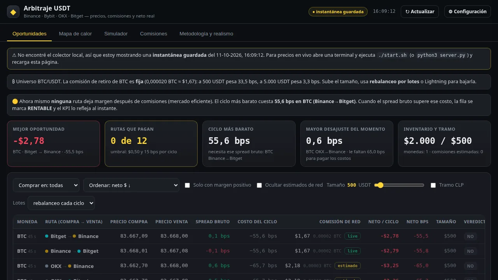

# Arbitraje USDT · datasheet

**Software & IA · mercado de capitales**

Arbitraje USDT — Doce rutas entre Binance, Bybit, OKX y Bitget, con un motor que resta comisiones, slippage, red y rebalanceo antes de decir que hay una oportunidad.

## Ficha

| Métrica | Valor |
|---|---|
| 4 | exchanges |
| 12 | rutas |
| 0 | API keys |
| 1 | snapshot |

## Qué resuelve

La diferencia de precio entre dos exchanges es solo el primer número. Después vienen las comisiones que se comen el margen.

## Cómo se opera

1. **Elegir un par** — El tablero muestra BTC/USDT y las rutas disponibles entre los cuatro exchanges.
2. **Leer el neto** — Cada fila resta taker de compra y venta, slippage, red y rebalanceo. El número grande es el que importa.
3. **Filtrar por umbral** — Una ruta por debajo del umbral se muestra en gris: el spread existe, pero no sobrevive a los costos.
4. **Simular** — El simulador mueve inventario y permite repetir el ciclo para ver el efecto de las comisiones.

## Flujo técnico

| Etapa | Qué ocurre |
|---|---|
| Recolectar | El servidor consulta tickers y libros de Binance, Bybit, OKX y Bitget. Cada exchange tiene su propio ritmo y su propio cache. |
| Normalizar | Los pares, las comisiones y los tamaños se llevan a una misma unidad para que las rutas sean comparables. |
| Restar costos | El motor aplica taker de compra y venta, slippage, comisión de red y una reserva de rebalanceo. |
| Ranking | Cada ruta recibe un neto en USDT y en puntos base. El mapa de calor muestra dónde se concentra el margen. |
| Simular | El simulador mueve inventario y muestra cómo cambia la ganancia al repetir el ciclo, sin tocar una cuenta real. |

## Capturas

*Vista principal: oportunidades, rutas y veredicto por costo neto.*

## Límites

| Límite | Detalle |
|---|---|
| No ejecuta órdenes | Es un tablero de análisis. La ejecución y la custodia quedan fuera del proyecto. |
| Comisiones de retiro | Bybit y OKX no siempre publican el costo de retiro; se usa una estimación declarada. |
| Datos públicos | Los endpoints pueden cambiar o limitar tasa. El snapshot existe para eso. |
| Impuestos | Las ganancias se declaran según la normativa chilena. El proyecto no calcula impuestos. |

## Preguntas frecuentes

**¿Necesito API keys?**

No. El colector solo lee endpoints públicos y el modo snapshot funciona sin red.

**¿Manda órdenes?**

No. El proyecto no firma ni envía transacciones; solo calcula y muestra.

**¿De dónde salen las comisiones?**

De las páginas públicas de cada exchange. Cuando no hay dato, se marca como estimado.

**¿Por qué el resultado puede ser negativo?**

Porque el motor resta todos los costos. Un spread positivo puede desaparecer después de comisiones y slippage.

## Seguridad

El proyecto no usa API keys, no firma transacciones y no envía órdenes. Solo lee endpoints públicos. Aun así, revisá las condiciones de cada exchange antes de operar.

## Enlaces

- [README](../README.md)
- [Developer](developer.md)
- [Página del proyecto](https://jmadasme.github.io/arbitraje/)
